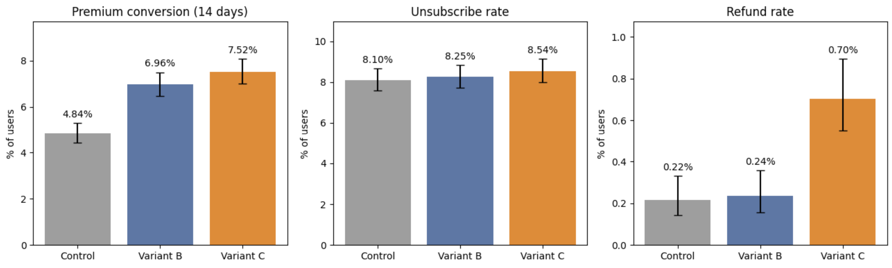

# LearnLoop AI Assistant Campaign: A/B Test Analysis

**Should LearnLoop launch a campaign promoting its new AI learning assistant, which message works best, and who should receive it?**

> **Note: synthetic data.** All data in this project was generated for portfolio purposes and contains deliberately planted data quality issues and effects. The results show how I would analyse and decide on a real experiment. They are not findings about a real company.

## Business problem

LearnLoop is a subscription-based learning app (Python, mathematics, communication skills, data analytics). It recently launched an AI-powered learning assistant that explains concepts, answers questions, creates practice questions and helps students understand mistakes. Few users are trying it, so the team ran a 28-day campaign (1-28 Aug 2026) with three arms:

- **Control:** no campaign message
- **Variant B:** benefit-focused message
- **Variant C:** discount-focused message

Business questions: Should the company launch the campaign? Which variant performs best? Which segments respond best? Is the improvement statistically significant? Should it roll out to everyone or target specific segments?

## Key results

Primary metric: premium subscription within 14 days of assignment. Guardrails: unsubscribes and refunds.

| Metric (14 days) | Control | Variant B | Variant C |
|---|---|---|---|
| Users analysed | 9,682 | 9,323 | 9,261 |
| Premium conversion | 4.84% | 6.96% | 7.52% |
| Lift vs control | n/a | +2.12 pp (95% CI 1.45 to 2.79) | +2.67 pp (95% CI 1.99 to 3.36) |
| Conversion net of refunds | 4.63% | 6.73% (+2.10 pp, CI 1.44 to 2.76) | 6.81% (+2.19 pp, CI 1.53 to 2.85) |
| Unsubscribe rate | 8.10% | 8.25% (+0.15 pp, not significant) | 8.54% (+0.44 pp, not significant) |
| Refund rate (share of users) | 0.22% | 0.24% (not significant) | 0.70% (+0.49 pp, 95% CI 0.30 to 0.69) |
| Refunds as share of converters | 4.5% | 3.4% | 9.3% |



- Both variants significantly increase conversion (p < 0.001, Bonferroni-adjusted for two comparisons). Arm sizes are balanced (sample ratio mismatch test: p = 0.60).
- **B vs C directly:** C converts +0.55 pp more than B, but the difference is not significant (95% CI -0.19 to 1.30, p = 0.14). Net of refunds the difference is +0.09 pp (95% CI -0.63 to 0.81, p = 0.81). C's refund rate is +0.47 pp higher than B's (95% CI 0.27 to 0.67, p < 0.001).
- So the two messages deliver about the same benefit after refunds, and only C carries a guardrail cost.

### Segments (exploratory)


Eleven platform x country segments with at least 300 control users were tested for each variant (22 comparisons). After correcting for all 22, **only Variant C on Android in India holds up**: +4.0 pp (95% CI 2.5 to 5.5, adjusted p < 0.001). Android in Indonesia shows about +4 pp for both variants but does not survive the correction (adjusted p = 0.06 to 0.08). Variant C is flat for iOS in the USA (-0.5 pp, not significant).

### Targeting: uplift model vs a simple rule

A cross-fitted uplift model (gradient boosting, two-model approach, scikit-learn) **did not reliably identify who responds**. Measured uplift across predicted-uplift quintiles was flat and noisy (B: 2.5, 3.3, 0.2, 1.3, 3.3 pp; C: 2.2, 3.0, 3.6, 2.4, 2.2 pp), and the gain curves stayed close to random targeting.


A simple rule, Variant C only for Android users in India (4,185 users, 22.1% of the population), gave +4.0 pp uplift and captured 33% of the total incremental conversions, against +2.1 pp and 17% for the model's top 22% of users. Net of refunds the rule still gave +3.4 pp (35% of the benefit vs 24% for the model).

## Recommendation

1. **Launch the campaign.** Both variants beat control.
2. **Roll out Variant B broadly.** It delivers about the same net benefit as C with no measurable guardrail cost.
3. **Use Variant C only for Android users in India**, with refund monitoring.
4. **Target with a simple, explainable rule** and not the uplift model, and confirm the Android India result (and Android Indonesia) in a follow-up experiment that runs longer than 14 days.

## Approach

```
Raw CSVs -> MySQL staging tables -> validation checks -> cleaned tables -> analysis_users (one row per user)
                                                                                |
                                                           Google Colab: A/B tests, guardrails, segments, uplift model
```

1. **MySQL (schema `fac`):** loaded raw CSVs as text into staging tables, ran validation checks, then cleaned and typed the data (see `docs/data_quality_log.md`).
2. **Analysis table:** built `analysis_users`, one row per eligible user, with 14-day conversion, refund and unsubscribe flags.
3. **A/B analysis (Python, Colab):** sample ratio check, two-proportion z-tests with confidence intervals for the difference, Bonferroni adjustment (2 comparisons for the primary metric and guardrails, 22 for segments), net-of-refund conversion, and a direct B vs C comparison.
4. **Targeting (Python, Colab):** cross-fitted two-model uplift estimate with 5-fold cross-fitting, measured uplift by predicted-uplift quintile, gain curves, and a comparison against a simple segment rule.

## Data

| Table | Rows | Description |
|---|---|---|
| users | 60,000 | Demographics, country, platform, acquisition channel, prior engagement |
| experiment_assignments | 60,900 | Variant, assignment timestamp, exposure flag (includes duplicates and conflicts) |
| subscriptions | 7,000 | Plan, price, currency, start date, status, refund flag |
| campaign_events | 611,877 | App opens, feature use, email and push events, unsubscribes |
| campaign_costs | 252 | Daily spend and impressions by variant and channel |

Analysis population: 28,266 users assigned by 14 Aug 2026, excluding bot-like users and users who subscribed before assignment.

## Data quality highlights

The raw data was intentionally messy. Issues found and handled include: 300 users assigned to more than one variant (removed) and 600 duplicate assignment rows, 35 orphan subscriptions, mixed date formats, country aliases, missing values, uppercase event labels, price and currency outliers, bot-like users with very high event volumes, events outside the experiment window or before signup, and an Android `app_open` logging outage on 12-13 Aug.

Two issues changed the analysis design:
- **Censored outcome window:** subscription data ends on the last assignment date (28 Aug), so users assigned after 14 Aug do not have a full 14-day window. The primary analysis is restricted to users assigned by 14 Aug.
- **Pre-assignment subscribers:** about half of subscriptions start before the user's assignment. These users are excluded because a purchase that happened before treatment cannot be caused by it.

Full details are in [`docs/data_quality_log.md`](docs/data_quality_log.md).

## Repository structure

```
feature-adoption-campaign-ab-test/
├── README.md
├── data/
│   ├── raw/                  # original CSVs
│   └── cleaned/              # analysis_users.csv exported from MySQL
├── sql/
│   ├── 01_create_and_load_staging_tables.sql
│   ├── 02_validation_checks.sql
│   ├── 03_cleaning.sql
│   └── 04_analysis_table_and_funnel.sql
├── notebooks/
│   ├── 01_ab_test_analysis_and_segments.ipynb
│   └── 02_uplift_model_and_targeting.ipynb
├── docs/
│   ├── experiment_brief.md
│   ├── data_quality_log.md
│   └── recommendation_memo.md
├── reports/figures/          # charts used in this README
└── dashboard/                # Power BI dashboard (coming soon)
```

## Power BI dashboard

**Coming soon.** An interactive dashboard of the results (conversion, guardrails and segment lift by variant) is planned and will be added to `dashboard/` with screenshots.

## How to reproduce

1. Use MySQL 8.0 or later (window functions are required). Run the scripts in `sql/` in order. Enable `local_infile` for the load step and update the file paths in script 01.
2. Export `analysis_users` to `data/cleaned/analysis_users.csv`.
3. Open the notebooks in `notebooks/` in Google Colab, upload `analysis_users.csv` and run all cells.

## Limitations

- Synthetic data: effects were planted, so effect sizes are larger than in typical real-world experiments.
- Only users assigned by 14 Aug are analysed, so effects beyond 14 days and novelty effects cannot be assessed.
- Segment results are exploratory. Only one of 22 segment comparisons holds after correction.
- The uplift model did not beat a simple rule. With about 9,300 users per arm and a low base conversion rate, there is little signal for a model to learn from.
- Campaign costs in the synthetic data are very small relative to subscription revenue, so ROI figures would be unrealistic and are not used for conclusions.
- Feature adoption (use of the AI assistant itself), channel-level performance and the engagement funnel were not analysed. The outcome measured is premium conversion.

## Next steps

- Follow-up experiment to confirm Variant C in Android India (and Indonesia), running longer than 14 days
- Feature adoption and channel analysis (email, push, in-app; feature view to feature use)
- Revisit the uplift model with more data or richer features
- Power BI dashboard (coming soon)

## Tools

MySQL 8.0 and MySQL Workbench, Python (pandas, NumPy, SciPy, statsmodels, scikit-learn, Matplotlib), Google Colab, Git/GitHub.
